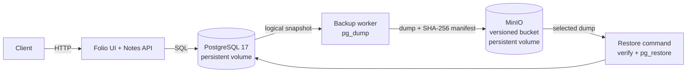

# Automated Database Backup, Versioned Storage, and Disaster Recovery for a Dockerized Web Application Using PostgreSQL and Automated DevOps Workflows

A small DevOps lab project showing how a database-backed application can create scheduled PostgreSQL backups, store uniquely named copies in local S3-compatible storage, and recover application data after database loss. Everything runs locally with Docker Compose; GitHub Actions runs the same workflow in a disposable environment.

## What runs



Express serves Folio, the browser workspace, and its PostgreSQL-backed Notes API. The backup container runs `pg_dump` in PostgreSQL custom format with compression, hashes the result, and uploads the dump and a JSON manifest under a unique UTC key. MinIO bucket versioning is enabled automatically. The restore command downloads the chosen dump, checks its manifest, size, and SHA-256 checksum, then applies it in a single PostgreSQL transaction.

MinIO is built locally from its checksum-verified `RELEASE.2025-02-07T23-21-09Z` source archive because the original public image is no longer pullable. Its S3 API, console, and data volume remain the same. The first uncached build includes Go compilation and needs internet access.

| Component | Role |
| --- | --- |
| Node.js 24, Express, `pg` | Folio browser workspace, REST API, and PostgreSQL client |
| PostgreSQL 17 | Notes database and logical dump source/target |
| Docker Compose | Local services, readiness checks, and persistent volumes |
| MinIO (verified-source build) | Local S3-compatible backup bucket with versioning enabled |
| Python, boto3, PostgreSQL client tools | Backup worker, listing, and restore CLI |
| GitHub Actions | CI plus a scheduled disposable backup/recovery demonstration |

## Start locally

For a short presentation, see the [seven-minute demo and speaking script](DEMO.md), including an introduction, commands, and recovery talking points.

Prerequisites: Docker Engine with the Compose plugin, `curl`, and Python 3 for the integration demo.

```sh
cp .env.example .env
# Optional: replace the example passwords in .env for your local environment.
docker compose up -d --build
```

Compose waits for PostgreSQL, MinIO, and the API health checks before starting the backup worker. The worker creates an initial backup after startup, then repeats every five minutes by default. Check service status and the API:

```sh
docker compose ps
curl http://localhost:3000/health
```

Open <http://localhost:3000> to use **Folio**, the browser notes workspace. Search and sort notes, create a note, select one to edit, then save or delete it. Changes use the same PostgreSQL-backed API described below. There is no login; Compose binds the app to localhost by default, so this workspace is for local use.

The API listens only on the local machine by default and has no authentication; it is intended for a local lab. Its routes are:

| Method | Path | Purpose |
| --- | --- | --- |
| `GET` | `/health` | Check API and database connectivity |
| `GET` | `/notes` | List notes |
| `POST` | `/notes` | Create a note with `title` and `content` |
| `GET` | `/notes/:id` | Read one note |
| `PUT` | `/notes/:id` | Replace a note's title and content |
| `DELETE` | `/notes/:id` | Delete a note |

Create a note and read it back:

```sh
curl -X POST http://localhost:3000/notes \
  -H 'Content-Type: application/json' \
  -d '{"title":"Lab note","content":"Back this up"}'
curl http://localhost:3000/notes
```

Open the MinIO console at <http://localhost:9001>. Sign in with `MINIO_ROOT_USER` and `MINIO_ROOT_PASSWORD` from `.env`; open the `notes-backups` bucket to view dump and manifest objects.

## Configuration

Copy `.env.example` to `.env`. Compose reads these values; the example uses local demo credentials and is not for a production deployment.

| Variable | Default | Purpose |
| --- | --- | --- |
| `POSTGRES_DB` | `notes` | Database created for the app |
| `POSTGRES_USER` | `notes` | PostgreSQL app and backup user |
| `POSTGRES_PASSWORD` | example value | PostgreSQL password; required by Compose |
| `MINIO_ROOT_USER` | `minioadmin` | Local MinIO login and S3 access key |
| `MINIO_ROOT_PASSWORD` | example value | Local MinIO password and S3 secret; required by Compose |
| `BACKUP_BUCKET` | `notes-backups` | Bucket created and versioned by the backup CLI |
| `BACKUP_INTERVAL_SECONDS` | `300` | Seconds between scheduled worker attempts |
| `APP_VERSION` | `dev` | Version label copied into backup metadata |
| `APP_PORT` | `3000` | Local API port |
| `MINIO_PORT` | `9000` | Local S3 API port |
| `MINIO_CONSOLE_PORT` | `9001` | Local MinIO web console port |

Keep `.env` private; it is excluded by `.gitignore`. Changing `POSTGRES_PASSWORD` after PostgreSQL has initialized its persistent volume does not change the password for the existing database role. The backup service receives PostgreSQL and MinIO connection values from Compose. It uses bounded S3 request timeouts and PostgreSQL's `PGCONNECT_TIMEOUT` so unavailable services fail with a useful error rather than hanging indefinitely.

## Create and inspect backups

A backup has a unique name such as `backups/2026-10-05/20261005T123456Z-<uuid>.dump`. A companion `.json` object contains the key, UTC timestamp, database name, file name, SHA-256 checksum, size, and application version. The custom-format dump uses PostgreSQL's built-in compression; it is not a `.sql.gz` file and is restored with `pg_restore`.

The worker attempts a backup immediately on startup and then follows `BACKUP_INTERVAL_SECONDS`. To run one now or list completed backup pairs:

```sh
./scripts/backup.sh
./scripts/list-backups.sh
```

The backup command prints the dump's object key. Use that key when restoring. A backup is listed only once its dump and companion manifest have both been uploaded. The worker logs failures and retries at its next interval. Multiple unique keys preserve multiple recovery points. MinIO bucket versioning is also enabled; if a key is overwritten, MinIO keeps its previous object version, visible in the console.

## Restore and recover

Pass a key shown by `./scripts/list-backups.sh`:

```sh
./scripts/restore.sh 'backups/2026-10-05/20261005T123456Z-<uuid>.dump'
```

The script asks you to type `restore` before proceeding. It stops the app and scheduled worker while restoring, then returns those services to their original running state, including when restoration fails. For automation, `--yes` skips the prompt:

```sh
./scripts/restore.sh "$BACKUP_KEY" --yes
```

The lower-level CLI is also available through Compose:

```sh
docker compose run --rm --no-deps backup list
```

The Python CLI also supports a restore command for automation and the isolated integration demo, but it does not stop application writers. The host wrapper owns downtime handling for a running local stack; use it for regular recovery. Restore rejects malformed object keys and mismatched manifests. It verifies both the recorded byte size and SHA-256 before calling `pg_restore`; a checksum or download error leaves PostgreSQL untouched. The restore uses `--clean --if-exists --single-transaction --exit-on-error`, so a failed import rolls back its database changes.

### Disaster-recovery lab

The quickest complete exercise runs in a separate Compose project with temporary ports and volumes:

```sh
./scripts/demo.sh
```

The demonstration creates notes, makes two uniquely named backups, checks the MinIO manifest/checksum/versioning, and changes and deletes notes. It then stops writers, checks the PostgreSQL volume's Compose ownership labels, deletes only that isolated database volume, and verifies the recreated database is empty. It restores the selected backup and compares every returned note field with the saved snapshot. MinIO's backup volume survives until test cleanup. The script removes only its own temporary containers and volumes when it exits, so it does not alter data from the normal `docker compose up` stack.

To explore the regular local stack manually, create notes, run `./scripts/backup.sh`, save the returned key, then make changes through the API and use `./scripts/restore.sh "$BACKUP_KEY"`. The wrapper stops active writers before recovery. Do not delete the MinIO volume before restoring: it contains the backup objects.

## Persistence and cleanup

PostgreSQL data and MinIO objects live in named Docker volumes. Recreating or upgrading a container with `docker compose up -d --build` keeps those volumes. Stopping the stack also keeps data:

```sh
docker compose down
```

This command removes containers and the Compose network, but retains the named database and object-storage volumes. To remove the local demo data as well:

```sh
docker compose down -v
```

`down -v` permanently removes PostgreSQL data and MinIO backups for this Compose project. The separately named volumes used by `./scripts/demo.sh` are isolated and removed by that script.

## GitHub Actions

The CI workflow runs Node syntax checks and API tests, Python backup/restore unit checks, Compose validation, Docker image builds, and the end-to-end recovery script on pushes and pull requests. The scheduled workflow runs the same backup/recovery exercise daily at 03:17 UTC and can also be started manually.

Both recovery jobs retain their output as downloadable GitHub Actions artifacts, including failed runs. The daily schedule is 08:47 in India. The application and container/recovery CI jobs run independently.

GitHub-hosted runners create a temporary PostgreSQL/MinIO environment, exercise it, and tear its volumes down. This demonstrates automation in CI; it does not connect to or continuously back up a developer's or organization's local database.

## Run checks locally

```sh
(cd app && npm ci && npm run lint && npm test)
python3 -m unittest discover -s backup/tests -v
docker compose --env-file .env.example config --quiet
docker compose --env-file .env.example build
./scripts/integration.sh
```

The `npm run lint` command uses Node's built-in syntax checker; it does not run ESLint. The integration script starts a fresh, isolated stack and removes its temporary volumes at the end. It needs a working Docker daemon and free local ports. `./scripts/demo.sh` is an equivalent, friendlier entry point.

## Recovery expectations and limits

The worker waits five minutes after each attempt finishes, so the normal start-to-start backup cadence is five minutes plus the time each dump takes. The recovery point can be older after an outage or failed attempts; this is a logical snapshot schedule, not continuous replication. Recovery time depends on database size and startup/import speed and is not a fixed guarantee.

This lab stores backup data in MinIO on the same Docker host as PostgreSQL. It demonstrates recovery from an application-level deletion or database-volume reset, but it does not protect against loss of the host or its disks. Move copies off-host for real disaster recovery. The project also does not back up PostgreSQL cluster roles/global objects, WAL for point-in-time recovery, or encrypt/sign backup objects. Its manifest checksum detects accidental corruption when the dump and manifest remain trustworthy; an actor with write access to both can replace both. MinIO root credentials are used for simplicity and should be replaced with restricted credentials before adapting this design to a shared environment.

Possible next steps for a larger deployment include off-host replication, least-privilege object credentials, manifest signing, retention rules, and PostgreSQL WAL archiving. They are intentionally outside this local teaching demo.

## Project report and verified results

Authors: **Om Lanke — 16010123216** and **Saish Korgaonkar — 16010123294**.

- [Editable Word report](report/DevOps_Mini_Project_Report.docx)
- [PDF report](report/DevOps_Mini_Project_Report.pdf)
- [Verification evidence](report/evidence/verification.md)
- [Report sources and rebuild instructions](report/README.md)

The report follows the supplied sample's academic layout, institution header, red sidebar, numbered chapters, tables, and grayscale diagrams. It explains the problem before the implementation and includes the actual recovered data and manifest. The supplied sample is preserved.

Local verification on 11 November 2026 passed **5 application tests and 13 Python tests**, Compose validation, the existing recovery demo, and a browser-driven Folio recovery exercise after isolated PostgreSQL-volume loss. The 36-page report includes eight live application/recovery screenshots and verified page references. The Node dependency audit reports zero advisories. Remote GitHub Actions execution and production container security were not tested.

## License

Project code: MIT. See [LICENSE](LICENSE). Third-party components retain their own licenses; MinIO is AGPL-3.0 and its license is included in the built image. The pinned MinIO release is for this local lab; assess upstream maintenance and vulnerabilities before production use.
